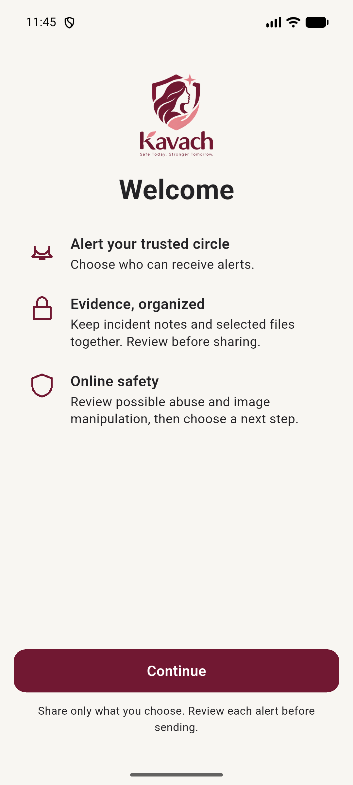
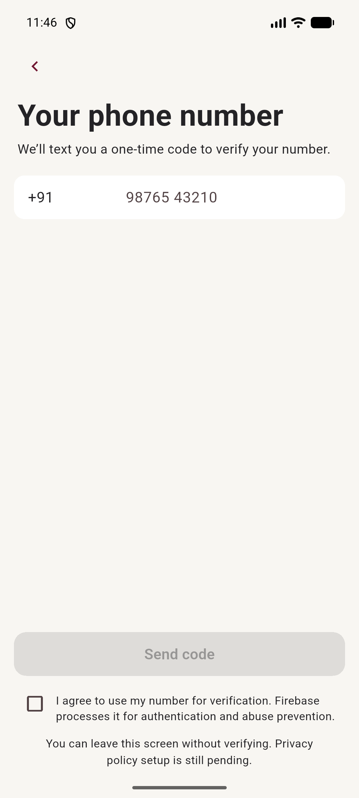

# Kavach

Kavach is a Flutter app for women's safety preparation, trusted contacts, incident records, travel awareness, and digital-safety guidance. It is built for Android and iOS. The project is still under development: some screens are working local experiences, while emergency delivery and several connected services are not yet available. Read [Current capabilities and limitations](#current-capabilities-and-limitations) before relying on the app in a real emergency.

## App preview

Welcome screen captured from the Pixel 7 Android emulator:



Phone sign-in screen (the displayed number is an unsubmitted example value):



App mark:


## What’s in the app

- Onboarding for phone sign-in, permissions, profile, PIN, and first trusted contact.
- Trusted Circle contact management.
- A confirmed handoff to the phone app for calling 112.
- Safe Journey destination search and a foreground map preview.
- Safety Map with community reports and nearby OpenStreetMap-listed places.
- Vault cases, notes, encrypted local evidence, recordings, and PDF export.
- Shield flows for message and media checks, including consent and result screens.
- Simulated Fake Calls with caller details, scheduled ringing, and spoken dialogue.
- Help resources and Guided Help topics.
- Settings UI for permissions, privacy, and safety preferences.

See the feature table below for what each feature actually does and what remains incomplete.

## Requirements

- Flutter stable **3.44.3** or newer, with the matching Dart SDK (**3.12.2** or newer).
- Android Studio and Android SDK for Android builds; a Pixel 7 emulator is available as `Pixel_7` in this development setup.
- macOS with Xcode and CocoaPods for iOS builds.
- Git.

The Android application ID is currently `com.example.kavach`. The checked-in Firebase platform files are configured for the project currently used by this app. A fork or a different deployment must use its own approved Firebase project configuration.

## Run on Android (Pixel emulator)

From the repository root:

```sh
flutter doctor
flutter pub get
flutter emulators
```

Start the Pixel emulator. In this setup its emulator ID is `Pixel_7`:

```sh
flutter emulators --launch Pixel_7
```

Wait for Android to finish booting, then list Flutter devices and run Kavach on the emulator ID shown (commonly `emulator-5554`):

```sh
flutter devices
flutter run -d emulator-5554
```

You can also run `flutter run` to select a connected device interactively. Keep the terminal open while using Flutter hot reload (`r`) or hot restart (`R`); press `q` to stop the debug session.

To build an installable Android debug APK:

```sh
flutter build apk --debug
```

The APK is written to `build/app/outputs/flutter-apk/app-debug.apk`.

## Run on iOS

Connect an iPhone or boot an iOS Simulator, then run:

```sh
flutter pub get
cd ios
pod install
cd ..
flutter devices
flutter run -d <device-id>
```

**Current iOS build blocker:** the Firebase Swift Package products in this project require iOS 15 or later, while the Runner target is currently set to iOS 13. The iOS build therefore fails until the project’s minimum iOS deployment target is deliberately raised to a compatible version. The project has not yet recorded a product decision for its minimum supported iOS version. Android is the currently verified launch path.

## Firebase and connected services

The app initializes Firebase from `lib/firebase_options.dart`; Android and iOS Firebase configuration files are also present. Phone sign-in and Firestore-backed profile/contact/map features depend on the configured Firebase project and enabled services. If you fork Kavach, register your own Android/iOS apps and replace these generated configuration files using your approved Firebase setup. Do not put service credentials or API secrets in Dart source.

Some functionality also needs external services or device capability:

- Shield image/video analysis requires the Firebase Functions and Storage backend to be deployed and its `RESEMBLE_API_KEY` secret configured.
- Safety Map and journey maps use OpenStreetMap services; destination search uses the public Nominatim endpoint.
- Audio capture, camera, location, notifications, secure storage, TTS, and photo selection use platform plugins and require appropriate device permissions.

The app can be built without deploying the Shield analysis backend, but that analysis will not be live. Do not treat a screen preview as proof that a remote operation completed.

## Feature status and limitations

| Area | Implemented behavior | Important limits |
|---|---|---|
| Onboarding and account | Phone sign-in flow, profile persistence, secure PIN storage, and permission requests are wired. | Phone verification and Firestore workflows still need target-device validation. |
| Trusted Circle | Add, edit, and remove contacts using the app’s repository flow. | Contacts are not sent an SOS by this build. |
| Emergency actions | Home and Help can ask before opening the phone app for 112 or listed helplines. | The app cannot verify that a call connected. SOS alert delivery to trusted contacts is not implemented. |
| Safe Journey | Search for a destination and view it on an OpenStreetMap map; request foreground location; manually confirm arrival. | No background tracking, automatic arrival detection, route guidance, battery handoff, or contact alert. |
| Safety Map | Browse map reports and nearby OSM-listed places; submit a report for moderation. | Nearby listings are not guaranteed facilities. Only approved reports are shown; approval is moderation, not factual verification. No background location. |
| Vault | Local cases and notes; encrypted evidence files; audio/video capture up to 60 seconds with review; hashes and device timestamps; deletion; PDF preview and share handoff. | Evidence capture, export, and share behavior still need device-level validation. SOS-triggered capture, location evidence, and retention controls are not implemented. |
| Shield | Message and image/video selection, consent, progress, and result screens; image saving to Vault. | Message analysis is illustrative and not connected. Image/video analysis is not live until backend deployment and secret configuration. Analysis is an estimate, not proof. |
| Fake Call | Configure caller name/photo and timing; simulated ringing, answer/decline, spoken dialogue, and call controls. | It is entirely simulated and never places or receives a real call. |
| Help and Guided Help | Emergency/support resources, web handoffs, and practical topic-based guidance. | External websites and phone handoffs depend on the device and network. |
| Settings | Settings UI contains permission, privacy, emergency, and safety preference sections. | The current router does not register `/settings`, so the Home settings button may not open this screen. Shake alert, SOS countdown, voice SOS, and decoy calculator are not active. |

**Not an emergency service:** SOS delivery, automatic emergency calling, background location, and automatic contact notifications are not available. Use local emergency services directly when needed.

## Project layout

```text
lib/
  main.dart                 # Firebase startup and app entry point
  app/                      # App composition, providers, and GoRouter
  core/                     # Shared design tokens and components
  features/                 # Feature-first modules
    onboarding/
    trusted_circle/
    emergency_call/
    journey/
    safety_map/
    vault/
    shield/
    fake_call/
    help/
    settings/
docs/                       # Product, design, architecture, and feature notes
test/                       # Unit and widget tests
functions/                  # Firebase callable function source
tool/check_architecture.dart
```

The code follows feature-first layers: presentation, application, domain, data, and infrastructure where each layer has a real responsibility. Riverpod provides application state/dependency wiring; GoRouter owns route definitions. See [Architecture](docs/ARCHITECTURE.md), [Rules](docs/RULES.md), and [Design](docs/DESIGN.md) before changing code.

## Development checks

Format Dart files you changed:

```sh
dart format lib test
```

Run static analysis, the architecture checker, and Flutter tests:

```sh
flutter analyze
dart run tool/check_architecture.dart
flutter test
```

Firestore security-rule tests are a separate Node task and may require network access to download their emulator dependencies:

```sh
npm run test:firestore-rules
```

## Documentation

- [Product requirements](docs/PRD.md)
- [Development phases](docs/PHASES.md)
- [Architecture](docs/ARCHITECTURE.md)
- [Coding rules](docs/RULES.md)
- [Design reference and evidence limits](docs/DESIGN.md)
- [Journey behavior and privacy](docs/JOURNEY.md)
- [Safety Map data and moderation](docs/SAFETY_MAP.md)
